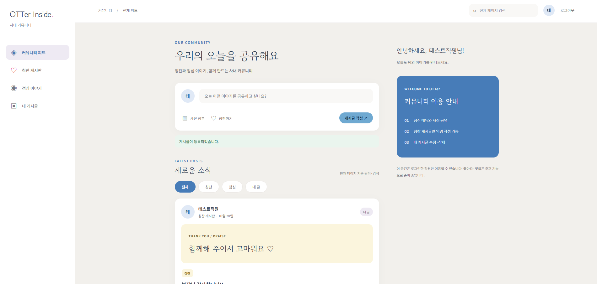

# OTTer Shield | Applications

| 앱 | 용도 | 배포 |
|---|---|---|
| [사내 게시판](m1-intranet/README.md) | 직원 간 칭찬·점심 이야기 공유 | M1 한국 · M2 독일 |
| [OTT 메인](m3-ott/README.md) | 영상 탐색·재생·한영 자막 | M3 한국 웹·API·DB · M5 영상 CDN |
| [Store](m5-store/README.md) | 굿즈 조회·장바구니·모의 주문 | M5 캐나다 AWS |

## 사내 게시판 · OTTer Inside

- 직원 번호 로그인 및 최초 비밀번호·닉네임 설정
- 칭찬·점심 게시글 등록, 본인 글 수정·삭제
- 칭찬 글 익명 작성, JPEG·PNG 사진 1장 첨부
- 피드형 목록과 페이지 이동, 현재 페이지 내 분류·검색

### 검증 자료

개발 PC 검증 · 2026-10-28

| 확인 항목 | 캡처 |
|---|---|
| 사진 첨부 화면 | [피드 내 사진 표시](m1-intranet/docs/evidence/ui-photo.png) |
| 백엔드 테스트 · 프론트엔드 빌드 | [테스트 성공](m1-intranet/docs/evidence/backend-test.png) · [빌드 성공](m1-intranet/docs/evidence/frontend-build.png) |
| 로그인 · 세션 유지 | [로그인 200](m1-intranet/docs/evidence/01-login-200.png) · [세션 조회 200](m1-intranet/docs/evidence/01-session-me-200.png) |
| 게시글 등록 · 수정 · 삭제 | [등록 201](m1-intranet/docs/evidence/02-post-create-201.png) · [수정 204](m1-intranet/docs/evidence/04-post-update-204.png) · [삭제 204](m1-intranet/docs/evidence/05-post-delete-204.png) |
| 입력 검사 · 접근 제한 | [공백 제목 400](m1-intranet/docs/evidence/06-blank-title-400.png) · [미로그인 401](m1-intranet/docs/evidence/08-unauthorized-401.png) |
| 사진 첨부 · 조회 · 삭제 후 접근 | [등록 201](m1-intranet/docs/evidence/09-post-image-create-201.png) · [조회 200](m1-intranet/docs/evidence/10-post-image-get-200.png) · [삭제 후 404](m1-intranet/docs/evidence/12-post-image-after-delete-404.png) |

[환경 설정](m1-intranet/README.md) · [전체 검증 캡처](m1-intranet/docs/evidence/README.md) · [테스트 기록·인계 확인](m1-intranet/docs/TEST_REPORT.md)

## OTT 메인

<!-- 메인 화면: 영상 콘텐츠가 추가된 뒤 실제 서비스 화면 캡처 삽입 -->

- 회원가입·로그인 및 세션 유지·로그아웃
- 공개 영상 목록·상세 정보 조회, 썸네일 표시
- 로그인 회원의 샘플 영상 재생, 한국어·영어 VTT 자막 선택
- 비로그인 재생 제한, 비공개 영상 조회·재생 차단

### 검증 자료

개발 PC 검증 · 2026-10-29

| 확인 항목 | 캡처 |
|---|---|
| 회원가입 · 입력 검사 | [가입 201](m3-ott/docs/evidence/01-signup-201.png) · [중복 409](m3-ott/docs/evidence/02-signup-duplicate-409.png) · [입력 오류 400](m3-ott/docs/evidence/03-signup-validation-400.png) |
| 회원 정보 DB 저장 | [MySQL 저장 확인](m3-ott/docs/evidence/04-signup-db.png) |
| 로그인 · 세션 유지 | [로그인 200](m3-ott/docs/evidence/05-login-200.png) · [세션 조회 200](m3-ott/docs/evidence/06-session-me-200.png) |
| 로그인 오류 · 로그아웃 | [로그인 실패 401](m3-ott/docs/evidence/07-login-invalid-401.png) · [로그아웃 204](m3-ott/docs/evidence/08-logout-204.png) · [세션 해제 401](m3-ott/docs/evidence/09-session-after-logout-401.png) |
| 영상 목록 · 상세 조회 | [목록 200](m3-ott/docs/evidence/10-video-list-empty-200.png) · [페이지 오류 400](m3-ott/docs/evidence/11-video-page-invalid-400.png) · [미존재 404](m3-ott/docs/evidence/12-video-not-found-404.png) |
| 비공개 영상 접근 제한 | [상세 404](m3-ott/docs/evidence/13-private-detail-404.png) · [재생 404](m3-ott/docs/evidence/14-private-playback-404.png) |

영상 재생·한영 자막은 로컬에서 확인했으며 화면 캡처는 추후 등록 예정. AI 자막 생성·Jenkins 배포·미디어 CDN 구축은 아직 검증 전.

[환경 설정](m3-ott/README.md) · [전체 검증 캡처](m3-ott/docs/evidence/README.md) · [ERD](../design/erd/ott/README.md) · [클래스 다이어그램](../design/classdiagram/ott/README.md)

## Store

메인 화면: 미등록 · 아래 기능은 개발 예정 범위입니다.

- Store 자체 회원가입·로그인
- 굿즈 목록·상세 조회
- 장바구니 추가·수량 변경·삭제
- 전체 또는 선택 상품 모의 주문, 배송 정보 입력 및 주문 내역 조회

[환경 설정](m5-store/README.md) · [ERD](../design/erd/store/README.md) · [클래스 다이어그램](../design/classdiagram/store/README.md)
