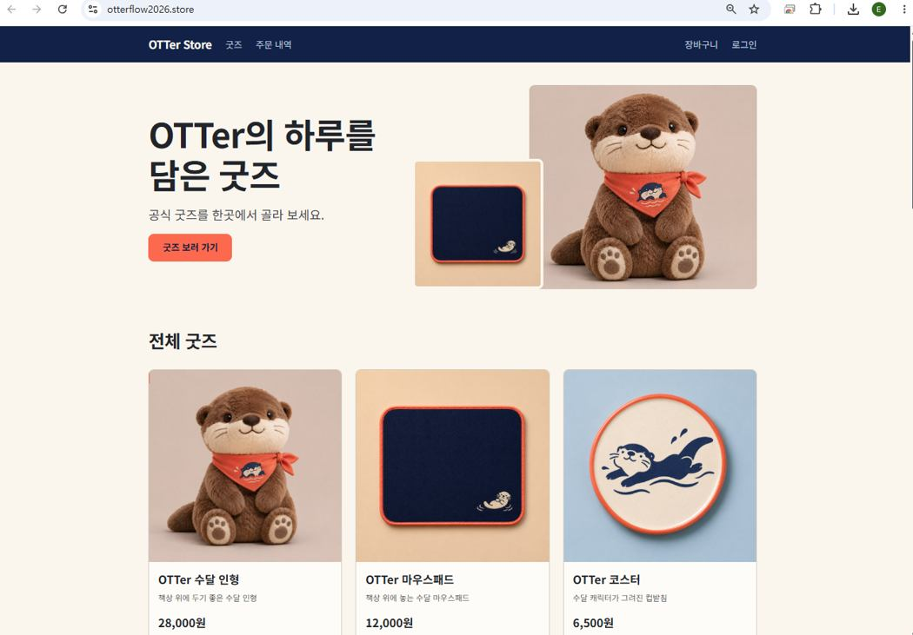
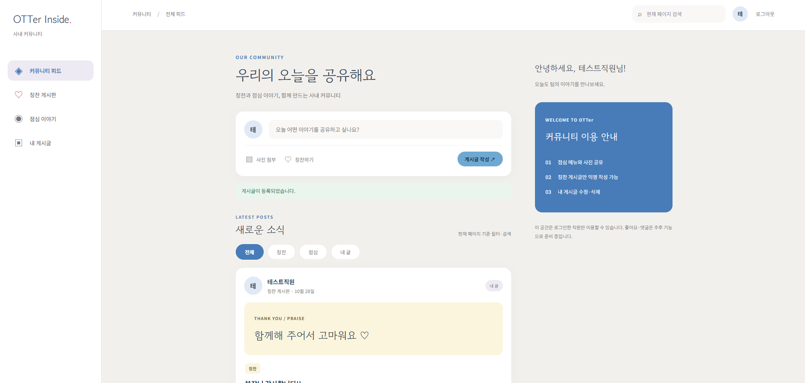
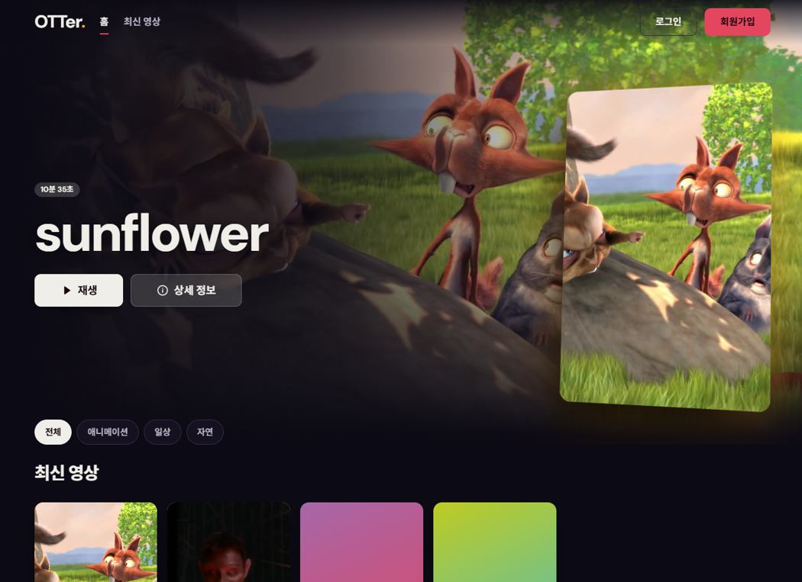

# OTTer Shield | 애플리케이션 개발

**유은혜 · M5 / PM** — 사내 게시판·OTT·굿즈 스토어 설계 및 개발, Store AWS 배포와 자동 배포 구성.

| 앱 | 직접 구현한 범위 | 확인한 결과 |
|---|---|---|
| [OTTer Store](m5-store/README.md) | 회원 세션, 굿즈 조회, 장바구니, 모의 주문, AWS 배포 | 공개 도메인에서 주문 완료, PR 머지 후 자동 배포 |
| [OTTer Inside](m1-intranet/README.md) | 직원 로그인, 게시글 CRUD, 사진 첨부 | 개발 PC에서 API·화면 검증 |
| [OTTer OTT](m3-ott/README.md) | 회원 세션, 영상 탐색·재생 권한, 한·영 자막 표시 | OTT 배포 화면에서 영상 재생과 두 자막 트랙 표시 확인 |

## OTTer Store

[공개 서비스](https://otterflow2026.store/) · [실행 및 배포 구성](m5-store/README.md)

- **구매 흐름:** 상품 선택 → [장바구니](docs/portfolio/store-cart.jpg) → [주문서](docs/portfolio/store-checkout.jpg) → [모의 주문 완료](docs/portfolio/store-complete.jpg). 실제 결제 없음.
- **자동 배포:** PR 머지 → GitHub Actions 이미지 빌드 및 ECR 업로드 → Git 배포 태그 갱신 → Argo CD가 EKS에 반영. [Actions #5](https://github.com/team-blocks-lab/otter-shield/actions/runs/42952968911) · [실행 캡처](docs/portfolio/store-actions.jpg).
- **배포 검증:** Actions 실행 #5의 커밋 `94f5128`과 EKS 웹 이미지 태그 일치, 롤아웃 성공, 공개 HTML에서 공유 미리보기 태그 확인.

[ERD](../design/erd/store/README.md) · [클래스 다이어그램](../design/classdiagram/store/README.md)

## 사내 게시판 · OTTer Inside

- 직원 번호 로그인 및 최초 비밀번호·닉네임 설정
- 칭찬·점심 게시글 등록, 본인 글 수정·삭제
- 칭찬 글 익명 작성, JPEG·PNG 사진 1장 첨부
- 피드형 목록과 페이지 이동, 현재 페이지 내 분류·검색

### 검증 자료

개발 PC 검증 · 2026-10-28

| 확인 항목 | 캡처 |
|---|---|
| 사진 첨부 화면 | [피드 내 사진 표시](m1-intranet/docs/evidence/ui-photo.png) |
| 백엔드 테스트 · 프론트엔드 빌드 | [테스트 성공](m1-intranet/docs/evidence/backend-test.png) · [빌드 성공](m1-intranet/docs/evidence/frontend-build.png) |
| 로그인 · 세션 유지 | [로그인 200](m1-intranet/docs/evidence/01-login-200.png) · [세션 조회 200](m1-intranet/docs/evidence/01-session-me-200.png) |
| 게시글 등록 · 수정 · 삭제 | [등록 201](m1-intranet/docs/evidence/02-post-create-201.png) · [수정 204](m1-intranet/docs/evidence/04-post-update-204.png) · [삭제 204](m1-intranet/docs/evidence/05-post-delete-204.png) |
| 입력 검사 · 접근 제한 | [공백 제목 400](m1-intranet/docs/evidence/06-blank-title-400.png) · [미로그인 401](m1-intranet/docs/evidence/08-unauthorized-401.png) |
| 사진 첨부 · 조회 · 삭제 후 접근 | [등록 201](m1-intranet/docs/evidence/09-post-image-create-201.png) · [조회 200](m1-intranet/docs/evidence/10-post-image-get-200.png) · [삭제 후 404](m1-intranet/docs/evidence/12-post-image-after-delete-404.png) |

[환경 설정](m1-intranet/README.md) · [전체 검증 캡처](m1-intranet/docs/evidence/README.md) · [테스트 기록·인계 확인](m1-intranet/docs/TEST_REPORT.md)

## OTTer OTT

**M5 유은혜:** 웹·API 개발, 영상 CDN 담당 · **M3 홍은서:** 웹·API·DB 배포 담당

- 회원가입·세션 인증, 공개 영상 조회, 로그인 회원의 영상 재생
- [상세 화면](docs/portfolio/ott-detail.jpg) · [한국어 자막 재생](docs/portfolio/ott-ko.jpg) · [영어 자막 재생](docs/portfolio/ott-en.jpg)
- 배포 화면은 영상과 자막 표시의 증거. 자막 생성 파이프라인은 [별도 실행 문서](m3-ott/ai-service/README.md) 참고.

### 검증 자료

개발 PC 검증 · 2026-10-29

| 확인 항목 | 캡처 |
|---|---|
| 회원가입 · 입력 검사 | [가입 201](m3-ott/docs/evidence/01-signup-201.png) · [중복 409](m3-ott/docs/evidence/02-signup-duplicate-409.png) · [입력 오류 400](m3-ott/docs/evidence/03-signup-validation-400.png) |
| 회원 정보 DB 저장 | [MySQL 저장 확인](m3-ott/docs/evidence/04-signup-db.png) |
| 로그인 · 세션 유지 | [로그인 200](m3-ott/docs/evidence/05-login-200.png) · [세션 조회 200](m3-ott/docs/evidence/06-session-me-200.png) |
| 로그인 오류 · 로그아웃 | [로그인 실패 401](m3-ott/docs/evidence/07-login-invalid-401.png) · [로그아웃 204](m3-ott/docs/evidence/08-logout-204.png) · [세션 해제 401](m3-ott/docs/evidence/09-session-after-logout-401.png) |
| 영상 목록 · 상세 조회 | [목록 200](m3-ott/docs/evidence/10-video-list-empty-200.png) · [페이지 오류 400](m3-ott/docs/evidence/11-video-page-invalid-400.png) · [미존재 404](m3-ott/docs/evidence/12-video-not-found-404.png) |
| 비공개 영상 접근 제한 | [상세 404](m3-ott/docs/evidence/13-private-detail-404.png) · [재생 404](m3-ott/docs/evidence/14-private-playback-404.png) |

[실행 방법](m3-ott/README.md) · [API 검증 캡처](m3-ott/docs/evidence/README.md) · [ERD](../design/erd/ott/README.md) · [클래스 다이어그램](../design/classdiagram/ott/README.md)
